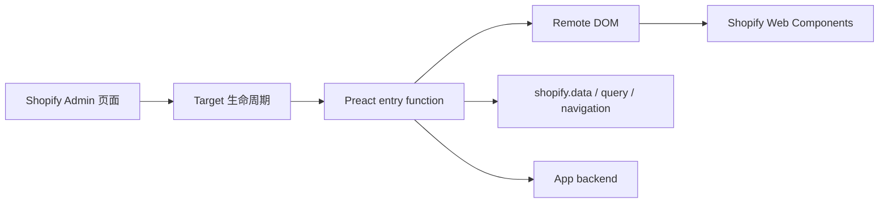

# 运行模型、配置与 Target

## 1. 运行模型



Admin UI Extension 不是普通的 iframe 页面。Shopify 在 Admin 中托管扩展，并通过 Remote DOM 将扩展产生的 UI 映射到宿主环境。开发者用 Preact 编写入口，但界面组件使用 Shopify 提供的 `s-*` Web Components，例如 `s-admin-block`、`s-admin-action`、`s-text` 和 `s-button`。

这带来三个实际约束：

1. 不要依赖任意 HTML/CSS 去重做 Shopify Admin 的视觉样式。
2. 不要假设普通浏览器 DOM 的所有能力都可用；以当前 target 支持的组件和 API 为准。
3. 把扩展保持得短小、快速和上下文明确；重业务放到 backend 或 Embedded App。

## 2. `shopify.extension.toml`

当前 demo 的核心配置：

```toml
api_version = "2026-07"

[[extensions]]
type = "ui_extension"
name = "Logistics learning block"
handle = "admin-ui-logistics-block"
uid = "397dee65-2933-4915-8d20-d34c9bd26a5f"

[[extensions.targeting]]
target = "admin.order-details.block.render"
module = "./src/order-details-block.tsx"
```

字段含义：

- `api_version`：Extension 使用的 Admin UI API 版本。
- `type`：Admin UI Extension 使用 `ui_extension`。
- `name`：商家在 Admin 看到的名字，建议稳定、可理解。
- `handle`：App 内唯一的内部标识。创建 draft version 或部署后不要随意改。
- `uid`：CLI 用来判断扩展是新增、更新还是删除的稳定标识。
- `target`：注入位置和能力集合。
- `module`：对应的 TSX/JSX 入口模块。

每个入口文件都导出一个异步默认函数，并在 `document.body` 上调用 Preact 的 `render()`。这三个 target 必须各占一个 extension，否则 `shopify app dev` 会拒绝启动 dev preview：

- `extensions/admin-ui-logistics-block`：`admin.order-details.block.render`
- `extensions/admin-ui-logistics-demo`：`admin.order-details.action.render`
- `extensions/admin-ui-logistics-selection`：`admin.order-index.selection-action.render`

## 3. Block

`admin.order-details.block.render` 在订单详情页内联显示内容。它适合快速回答“当前订单怎样了”，例如：

```tsx
const orderId = shopify.data.selected?.[0]?.id;

render(
  <s-admin-block heading="物流状态">
    <s-text>订单：{orderId}</s-text>
  </s-admin-block>,
  document.body,
);
```

Block 需要商家在订单详情页的 App block 设置中添加并固定。扩展部署成功不等于 Block 已经出现在所有店铺页面。

## 4. Action

`admin.order-details.action.render` 出现在订单详情页的 More actions 菜单，点击后打开 modal。Action 的容器需要主操作和次操作：

```tsx
<s-admin-action heading="刷新物流">
  <s-text>只展示当前订单上下文。</s-text>
  <s-button slot="primary-action" onClick={submit}>确认刷新</s-button>
  <s-button slot="secondary-actions" onClick={() => shopify.close()}>
    取消
  </s-button>
</s-admin-action>
```

提交后可以通过 `shopify.close()` 关闭 modal；如果是部分失败，应保留 modal 让商家看到失败项和重试路径。

## 5. Selection Action

`admin.order-index.selection-action.render` 出现在订单列表页的批量操作菜单。它通过 `shopify.data.selected` 收到多个订单 ID：

```tsx
const orderIds = shopify.data.selected.map(({id}) => id);
```

批量操作必须考虑去重、空选择、重复点击、部分失败、超时和重试。不要把整个订单对象从 URL 或 DOM 中猜出来，使用 Shopify 提供的上下文 ID，再由 backend 或 `shopify.query()` 获取最小必要数据。

## 6. 组件选择

优先使用官方 Web Components：

- `s-admin-block`：详情页内联卡片。
- `s-admin-action`：Action modal 的标题和操作区。
- `s-text`、`s-stack`、`s-badge`：信息布局和状态。
- `s-button`、`s-banner`：操作与错误反馈。

组件是否可用于某个 target 以当前官方 Web Components reference 为准。
