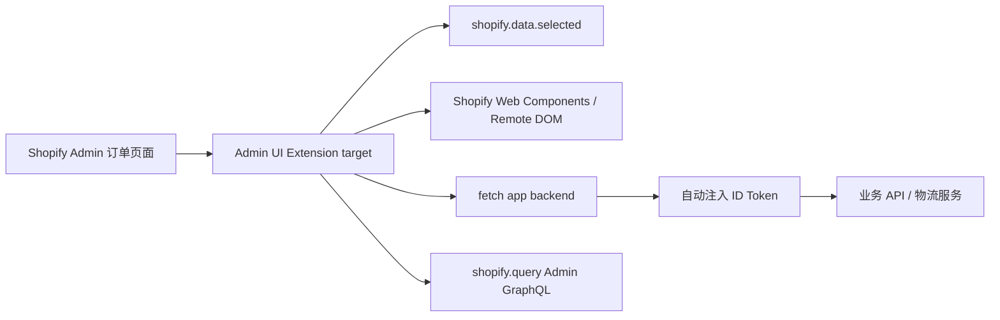

# Admin UI Extension 物流三件套学习 Demo 设计

## 目标

基于当前 Shopify App 模板，建立一套可讲解、可运行、可继续扩展的 Admin UI Extension 学习材料。第一阶段围绕订单物流场景实现三个 target：订单详情 Block、订单详情 Action、订单列表 Selection Action。

材料需要同时服务两类读者：

- 需要理解 Shopify Admin UI Extension 运行模型、Target、Web Components、上下文数据和认证方式的同事。
- 需要从模板中复制目录、配置和代码并继续开发业务扩展的同事。

## 范围

### 文档

新增 `docs/admin-ui-extensions/` 文档目录，至少包含：

- 学习路线和官方资料索引，说明 Admin UI Extension 与 Embedded App、App Backend 的职责边界。
- 运行模型：Shopify Admin 宿主、Remote DOM、Preact、Shopify Web Components、Target API。
- `shopify.extension.toml` 配置说明：`api_version`、`[[extensions]]`、`type`、`name`、`handle`、`uid`、`[[extensions.targeting]]`。
- 三类 target 的使用场景、生命周期、上下文数据和交互模型。
- `shopify.data.selected`、`shopify.query()`、`shopify.navigation.navigate()`、`fetch()` 与自动注入 ID Token 的使用说明。
- 后端鉴权、权限范围、错误处理、加载状态、幂等性、性能和数据最小化注意事项。
- 本地开发、Shopify CLI 调试、安装/固定 Block、部署和回滚检查清单。
- 常见故障：target 不出现、Block 未固定、配置 handle 变更、跨域请求、过度依赖 Admin API、版本不匹配。
- 三个 demo 的逐文件导读、演示脚本和后续练习。

文档使用中文解释，保留官方英文 API 名称和官方链接。官方参考基线为 Admin UI extensions API version `2026-07`；仓库根 Shopify App webhook 版本继续遵循现有配置，不在本次工作中混改。

### Demo

新增 `extensions/admin-ui-logistics-demo/` workspace，结构保持 Shopify CLI extension 的标准形态：

```text
extensions/admin-ui-logistics-demo/
  package.json
  shopify.extension.toml
  src/
    shared/
      context.ts
      logistics.ts
      ui.ts
    order-details-block.tsx
    order-details-action.tsx
    order-index-selection-action.tsx
  README.md
```

Demo 的三个 target：

| 场景 | Target | 教学重点 |
| --- | --- | --- |
| 订单详情 | `admin.order-details.block.render` | 读取当前订单、展示物流状态、处理加载和错误 |
| 订单详情 | `admin.order-details.action.render` | 打开 Admin Action modal、提交刷新操作、关闭 modal |
| 订单列表 | `admin.order-index.selection-action.render` | 读取多选订单、批量执行、汇总成功与失败 |

Demo 默认使用一个可替换的物流数据适配层：优先展示如何从当前资源提取 ID、组织请求和渲染状态；在没有真实后端时提供确定性的教学 mock。真实 API 接入点、ID Token 和错误边界要在文档中明确标注，避免把 mock 当作生产认证方案。

## 架构与数据流



Extension 只负责上下文内的轻量 UI 和操作。需要业务数据库、第三方物流请求、复杂聚合、权限判定或长耗时任务时，通过 App Backend 处理；Embedded App 用于完整物流详情、配置和报表。

## 关键技术决策

1. 使用官方 `ui_extension` 配置和 Preact/TSX 入口，遵循 Admin UI Extension 的 Remote DOM 和 Web Components 约束。
2. 使用 `s-admin-block`、`s-admin-action`、`s-button`、`s-text` 等官方组件，避免通过任意 CSS/HTML 复刻 Admin UI。
3. 从 `shopify.data.selected` 读取当前资源上下文；不把 URL 解析作为主要数据来源。
4. 业务请求封装在共享适配层，统一处理 mock、相对 URL、状态和错误，三个 target 不复制同一套请求逻辑。
5. 选择 Action 与 Selection Action 时，为空选择、部分失败、重复点击和超时设计明确状态。
6. 不在 extension 配置或前端源码中写入 client secret、Admin API token、店铺 token 或物流供应商密钥。
7. 保留 `shopify.app.toml` 的开发 App client ID 接入工作为单独配置变更；生产配置仍保持占位，避免把一个 client ID 同时当作生产 App。

## 验证标准

- `pnpm build:extensions` 能发现并构建新增 workspace，或在依赖未安装时给出可解释的失败信息。
- `shopify.extension.toml` 的三个 target、模块路径、API 版本和 handle 可被 Shopify CLI 识别。
- TypeScript/ESLint 检查通过，且 `shopify` 全局类型或 lint 声明不会产生隐式错误。
- 文档中的配置、命令、target 名称和 API 示例与官方 `2026-07` Admin UI Extension 文档一致。
- Demo 在没有真实物流后端时可通过 mock 完成演示；真实 API 接入步骤、认证边界和限制均有明确说明。
- 不修改生产 Shopify 配置，不提交任何 secret。

## 非目标

- 本阶段不实现真实物流供应商、数据库、Webhook 消费或生产级队列。
- 本阶段不实现 Print Action、Runnable、Configuration、Theme Extension 或 Shopify Function。
- 本阶段不把复杂业务页面塞进 Admin UI Extension；这类页面继续由 `apps/admin` 承担。
